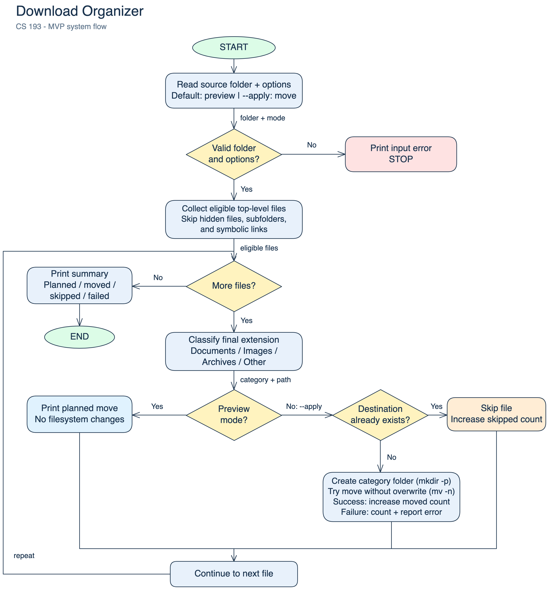

# CS 193 Homework 9 - Download Organizer

Planning due: November 1, 2026. Final project due: November 29, 2026.

## 1.1 Problem

Class documents, screenshots, and ZIP files can get mixed together in a downloads folder. I want to find what I need without sorting every file by hand.

## 1.2 Solution

I will write a Bash script that sorts files from a chosen folder into Documents, Images, Archives, and Other. It will show the planned moves first and will not replace existing files.

## 2.1 Eisenhower Matrix

### Do - Minimum Viable Product (MVP)

- Sort files from one folder into four categories.
- Preview the moves. Leave the files and folders unchanged.
- Move files with --apply. Keep their names and skip existing destination names.
- Ignore hidden files, subfolders, and symbolic links. Print the planned, moved, skipped, and failed totals.

### Schedule - later versions

- Let the user choose categories and file types.
- Save a text log of the moves.
- Add an undo command.

### Delegate - use existing commands

- Use mkdir -p to create folders.
- Use mv -n to move files without replacing existing files.
- Use tr for lowercase extensions.

### Delete - leave out

- A graphical app with buttons and windows.
- Cloud storage and syncing between devices.
- Automatic file deletion.

Documents: pdf, txt, doc, docx, ppt, pptx. Images: png, jpg, jpeg, gif. Archives: zip, tar, gz. Other: unrecognized types or files with no extension. Treat .PDF and .pdf as the same type.

## 2.2 Tech stack

- **Language:** Bash on macOS.
- **Commands:** mkdir -p for folders, mv -n for file moves, tr for lowercase extensions, and printf for messages.
- **Storage:** Files in local category folders. The counts reset each time the script runs.
- **Data source:** Files in the folder I choose.
- **Tools:** Terminal, a text editor, Git, GitHub, and Excalidraw.
- **Checks:** Try files with spaces, uppercase or missing extensions, and duplicate names. Check preview and apply modes, empty folders, and a second run. Check that hidden files, subfolders, and symbolic links stay untouched.

## 2.3 Build plan

Each milestone ends with a Git commit.

1. **Nov 1:** Set up the repository, README, matrix, design document, and diagram.
2. **Nov 5:** Read the folder path and options. Add --help and reject invalid input.
3. **Nov 8:** Choose a category from the file extension. Use Other for unknown or missing extensions.
4. **Nov 12:** Add preview mode. Check that it leaves files and folders unchanged.
5. **Nov 16:** Add --apply. Create the category folders, move files, and skip existing destination names.
6. **Nov 20:** Print the totals and report skipped files or errors.
7. **Nov 23:** Test spaces, uppercase and missing extensions, duplicate names, empty folders, and repeat runs.
8. **Nov 28:** Update the README and help text. Record the 3-4 minute walkthrough.

## 2.4 System diagram

## 3.1 Public repository

https://github.com/neelmd/cs193-download-organizer
