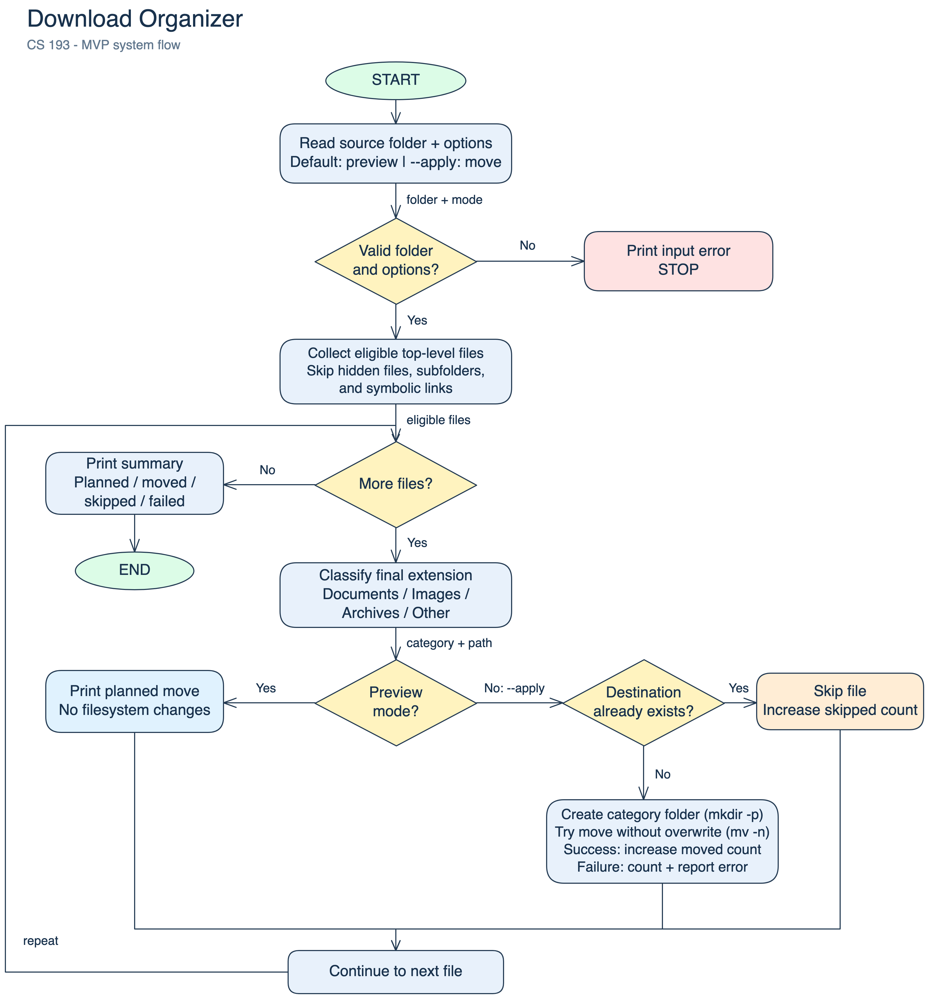

# Download Organizer

Downloads can pile up in one folder. This Bash script will sort them by file type and preview the moves.

## Minimum Viable Product (MVP)

- Sort files into Documents, Images, Archives, and Other.
- Preview moves. Use --apply to move files.
- Skip existing destination names.
- Leave hidden files, subfolders, and symbolic links alone.

## Tech stack

Bash on macOS: `mkdir -p`, `mv -n`, `tr`, and `printf`. Files stay in local folders.

## Future plans

Custom categories, a move log, and an undo command.

## Diagram

## Files

- [DESIGN.md](DESIGN.md): the full project plan.
- [docs/design.pdf](docs/design.pdf): a PDF copy of the plan.
- [Matrix](docs/eisenhower-matrix.md): which features to build, postpone, or leave out.
- [Build plan](docs/build-plan.md): eight milestones and their dates.
- [Diagram](docs/system-diagram.png): the steps the script will follow.
- [Diagram source](docs/system-diagram.excalidraw): the editable Excalidraw file.
- [Project notes](docs/project-explained.md): an example and definitions of the commands.
- `tests/`: test instructions and sample files.
